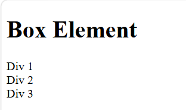

# Lab4Web
CSS Layout

Praktikum 4 merupakan latihan pemrograman web yang membahas pembuatan tata letak halaman website menggunakan HTML5 dan CSS. Praktikum ini mempelajari konsep Box Element, CSS Float, Clearfix, serta penggunaan elemen semantik HTML5 untuk membangun layout website sederhana.

## Result

