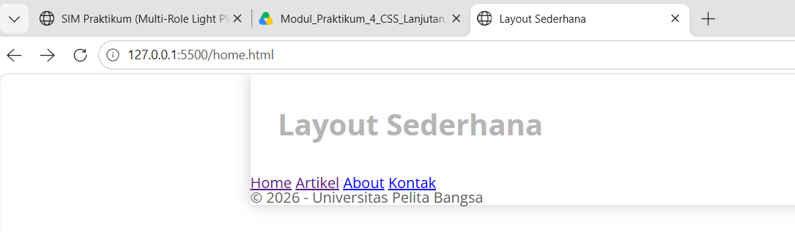
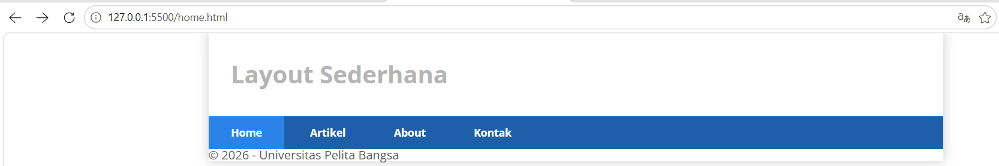
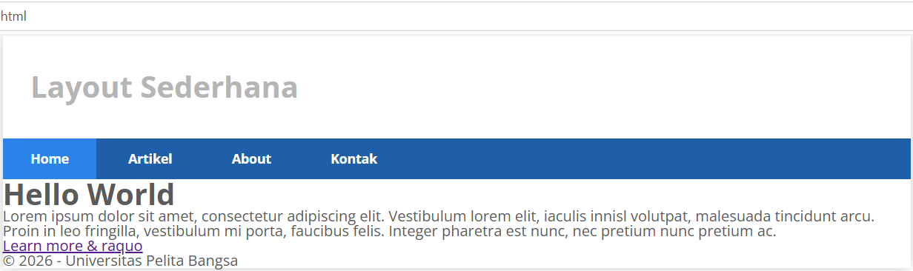
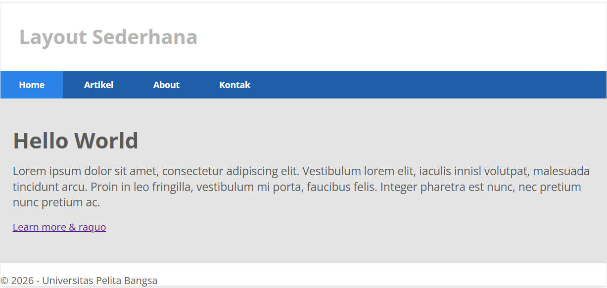
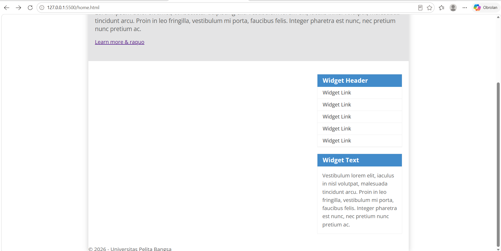
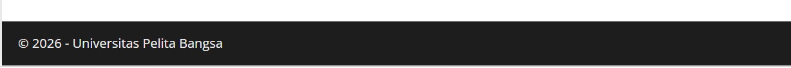
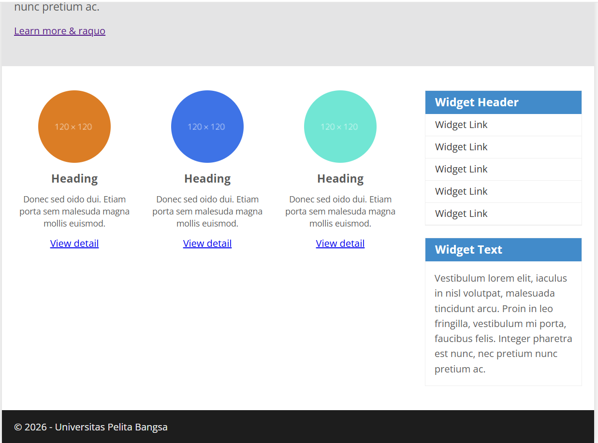
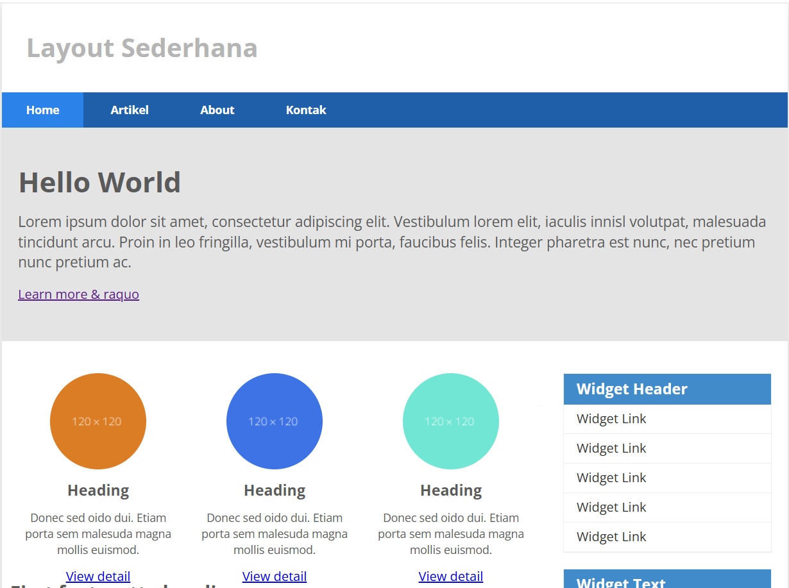
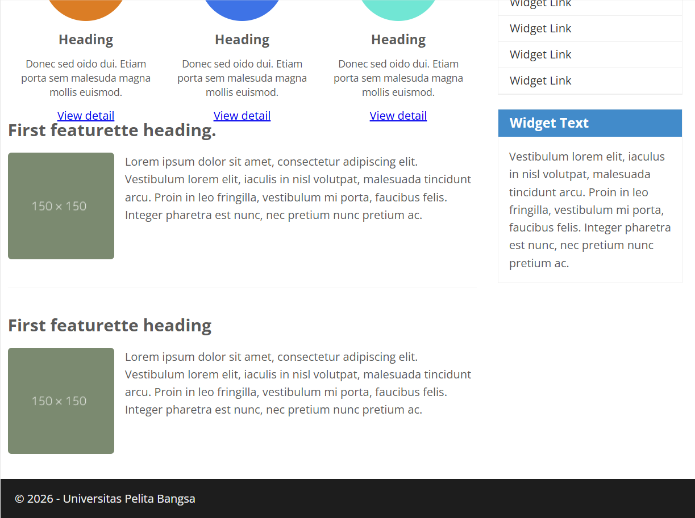

# Lab4Web

## Praktikum 4: CSS Layout

Praktikum 4 merupakan latihan pemrograman web yang membahas pembuatan tata letak halaman website menggunakan HTML5 dan CSS. Praktikum ini mempelajari konsep **Box Element, CSS Float, Clearfix**, serta penggunaan elemen semantik HTML5 untuk membangun layout website sederhana.

## 1. Box Element

Box Element merupakan konsep dasar CSS yang menganggap setiap elemen HTML sebagai sebuah kotak. Box Model terdiri dari empat bagian, yaitu Content, Padding, Border, dan Margin.

### Result 1 — Box Element


Hasil tampilan Box Element setelah diberikan style CSS.

### Result 2 — Box Element dengan CSS


### CSS Float Property

CSS Float digunakan untuk mengatur posisi elemen agar berada di sisi kiri atau kanan elemen lainnya. Properti ini dapat digunakan untuk membantu menyusun elemen dalam layout website.

Contoh penggunaan CSS Float:

```css
div {
    float: left;
    padding: 10px;
}

.div1 {
    background: red;
}

.div2 {
    background: yellow;
}

.div3 {
    background: green;
}
```

### Clearfix

Properti `clear` digunakan untuk mengatur posisi elemen agar tidak berada di samping elemen yang menggunakan `float`.

Contoh penggunaan CSS Clear:

```css
.div4 {
    background-color: blue;
    clear: both;
    float: none;
}
```

### Result 3 — Float dan Clear


Hasil percobaan penggunaan properti Float dan Clear pada elemen `div`.

## 2. Membuat Layout Sederhana

Pada tahap ini, dibuat layout website sederhana menggunakan HTML5 Semantic Elements, seperti `header`, `nav`, `section`, `article`, `aside`, dan `footer`.

### Result 4 — Struktur Layout


Hasil tampilan awal halaman `home.html` sebelum diberikan style CSS.

### Result 5 — Navigasi



Hasil tampilan navigasi setelah diberikan style CSS, meliputi warna latar belakang, warna teks, padding, dan efek hover.

### Membuat Hero Panel

Hero panel merupakan bagian halaman yang menampilkan judul utama, deskripsi singkat, dan tombol untuk mengarahkan pengguna ke informasi lebih lanjut.

### Result 6 — Hero Panel HTML



Tampilan hero panel setelah ditambahkan elemen HTML.

### Result 7 — Hero Panel dengan CSS



Hasil hero panel setelah diberikan style CSS untuk mengatur warna latar belakang, jarak, ukuran teks, dan tata letak.

### Membuat Sidebar Widget

Sidebar digunakan untuk menampilkan informasi tambahan, seperti daftar tautan dan widget teks.

### Result 8 — Sidebar Widget



Hasil tampilan sidebar widget setelah diberikan style CSS.

### Mengatur Footer

Footer merupakan bagian bawah halaman website yang biasanya berisi informasi hak cipta atau informasi tambahan lainnya.

### Result 9 — Footer



Hasil tampilan footer setelah diberikan style CSS.

### Menambahkan Main Content

Main content merupakan bagian utama website yang berisi informasi, gambar, judul, deskripsi, dan tombol detail. Pada tahap ini, elemen konten disusun menggunakan CSS Float dan Box Model.

### Result 10 — Main Content



Hasil main content setelah ditambahkan beberapa elemen berupa gambar berbentuk lingkaran, judul, deskripsi, dan tombol yang telah diberikan style CSS.

### Menambahkan Artikel

Artikel ditambahkan pada bagian konten utama untuk menampilkan informasi berupa judul, gambar, dan paragraf. Properti CSS Float digunakan untuk mengatur posisi gambar terhadap teks.

### Result 11 — Halaman Home Lengkap



Hasil tampilan keseluruhan halaman `home.html` setelah ditambahkan main content, artikel, sidebar, navigasi, dan footer.

## 3. Dokumentasi Hasil Praktikum

### Result 12



Dokumentasi tambahan hasil praktikum CSS Layout.

### Result 13



Dokumentasi tambahan hasil akhir praktikum.

## Kesimpulan

Melalui praktikum ini, mahasiswa dapat memahami konsep dasar pembuatan layout website menggunakan HTML5 dan CSS. Materi yang dipelajari meliputi Box Element, CSS Float, Clear, serta penggunaan elemen semantik HTML5.

Hasil praktikum berupa website sederhana yang terdiri dari header, navigasi, hero panel, main content, sidebar widget, artikel, dan footer. Dengan memahami materi ini, mahasiswa diharapkan mampu membuat tata letak website yang terstruktur, rapi, dan mudah dikembangkan.
