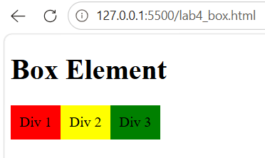
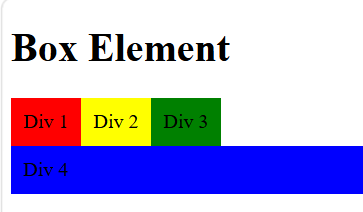
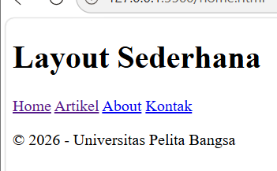

# Lab4Web
CSS Layout

Praktikum 4 merupakan latihan pemrograman web yang membahas pembuatan tata letak halaman website menggunakan HTML5 dan CSS. Praktikum ini mempelajari konsep Box Element, CSS Float, Clearfix, serta penggunaan elemen semantik HTML5 untuk membangun layout website sederhana.

## Result

Hasil setelah di beri style css

## Result

1. Box Element

Mempelajari struktur kotak pada elemen HTML yang terdiri dari:

Content: isi elemen.

Padding: jarak antara isi dan border.

Border: garis tepi elemen.

Margin: jarak antara elemen dengan elemen lainnya.

2. CSS Float Property

Menggunakan properti float untuk mengatur posisi elemen, seperti:

div {
    float: left;
    padding: 10px;
}

3. Clearfix

Menggunakan properti clear untuk mengatur posisi elemen setelah elemen yang menggunakan float.

.div4 {
    background-color: blue;
    clear: both;
    float: none;
}

## Result 

# Membuat Layout Sederhana

## Result

